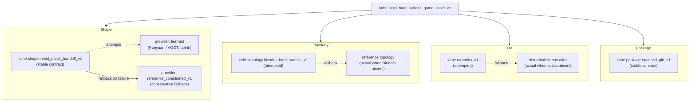

# Backends

A **backend stack** binds each pipeline stage to a concrete implementation by stable contract ID. Stack IDs and contract IDs are public surface: they must not change without a coordinated migration. The reference stack shipped in v0.1 is `lathe.stack.hard_surface_game_asset_v1`.

## Component diagram — `hard_surface_game_asset_v1`

Each stage binds to an **attempted** backend with an explicit **actual** fallback. The runtime records both so that trace output always shows which path was taken and why.

## Fallback semantics

- **Attempted vs actual.** Every stage trace records the backend that was *attempted* (from the stack binding) and the one that was *actual* (after capability probes and runtime checks). Traces include a reason for each fallback.
- **Conservative defaults.** With no `--runtime-config` given, shape falls back to `lathe.provider.shape.reference_conditioned_v1`; topology and UV fall back to deterministic reference paths when Blender or xatlas are unavailable. This keeps smoke tests and bootstrap flows ergonomic.
- **Stable IDs.** `lathe.shape.intent_mesh_handoff_v1`, `lathe.topology.blender_hard_surface_v1`, `lathe.uv.xatlas_v1`, `lathe.package.openusd_gltf_v1`, and `lathe.stack.hard_surface_game_asset_v1` are public contract identifiers. A breaking change requires either a MAJOR version bump or a new ID suffix (`_v2`). See [Versioning](../versioning.md).

## Registry boundary

`lathe/backends.py` is the built-in registry ground truth. Third-party
extensions add descriptors through the `lathe.backends`, `lathe.stacks`, and
`lathe.providers.shape` entry-point groups; they do not replace built-in IDs.
Provider adapter modules are internal implementation details below their
descriptor and provider report. Downstream consumers should read selected
backend IDs, provider IDs, and attempted-vs-actual trace fields, not import
adapter helpers directly.

See [Shape stage](shape_stage.md) for the internals of the probabilistic stage,
[Pipeline](pipeline.md) for the full stage order, and [Public contracts and
internal boundaries](contracts.md) for the full contract map.
