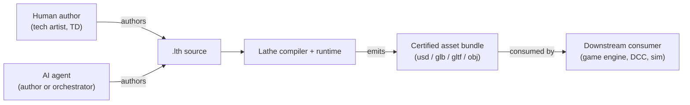
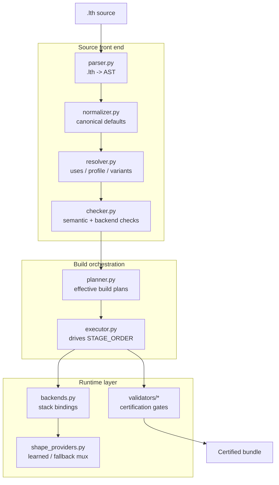

# Architecture overview

Lathe is a declarative language plus a reference compiler/runtime for 3D asset intent. An author — human or AI agent — writes a `.lth` source file describing *what* the asset is, *how* to build it, and *what counts as passing certification*. The Lathe compiler runs the source through a deterministic pipeline (with a single probabilistic shape stage) and emits a certified bundle of production-ready assets (usd / glb / gltf / obj) that downstream consumers such as game engines can load directly.

## C4 Level 1 — System context

The context diagram shows Lathe's place in a production asset pipeline. Authors produce intent in `.lth` source files; the compiler converts that intent into certified bundles; downstream consumers load those bundles without needing to know anything about the source language.

## C4 Level 2 — Container / component view

Inside the compiler, the source flows through a parse/normalize/resolve/check front end, into a planner that produces effective build plans, then into an executor that drives the stage pipeline. The executor delegates to backends, which may call optional providers for the single probabilistic stage (shape). Validators gate the output before packaging.

## Boundary rule

Lathe's public architecture is defined by source-language compatibility,
versioned backend/provider/stage contracts, schema-versioned manifests, and
persisted reports. Implementation modules may move behind those boundaries as
long as the observable contracts stay compatible. Downstream docs and tools
should depend on the contract surfaces, not on private helpers or transient
runtime dictionaries.

See [Pipeline](pipeline.md) for the stage-level flow, [Shape stage](shape_stage.md)
for the internals of the probabilistic stage, [Backends](backends.md) for the
stack-binding / fallback semantics, and [Public contracts and internal
boundaries](contracts.md) for the public surface map.
