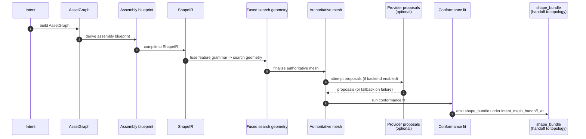

# Shape stage

Shape is the single probabilistic stage in the Lathe pipeline. It runs under the stable public contract **`lathe.shape.intent_mesh_handoff_v1`**: the input is frozen intent, the output is an authoritative mesh that downstream deterministic stages can safely consume.

Inside the contract, shape flows:

## Contract and provider mux

The contract ID `lathe.shape.intent_mesh_handoff_v1` is treated as a public, stable surface. The shape bundle is the handoff; downstream stages (topology, uv, surface, package) consume it without caring whether a learned provider ran or a reference fallback path did.

Provider proposals are *optional sources under a stable contract* — they are not the product center. `shape_providers.py` multiplexes between learned providers (declared via `--runtime-config`) and the conservative reference provider `lathe.provider.shape.reference_conditioned_v1`. When a provider falls back — because a runtime is unavailable, a capability probe fails, or a proposal does not pass fit — the trace records both the **attempted** and the **actual** provider. The same attempted-vs-actual pattern also applies to the Blender topology adapter and the xatlas UV adapter.

Key modules that implement this stage live in the `lathe/` package: `asset_graph.py`, `assembly_kernel.py`, `scaffold_compiler.py`, `shape_ir.py`, `feature_grammar.py`, `feature_fusion.py`, `mesh_finalize.py`, `conformance.py`, `shape_backend.py`, `shape_providers.py`.

## Public vs internal shape surface

The public shape surface is the `lathe.shape.intent_mesh_handoff_v1` backend
descriptor and the emitted shape bundle fields pinned by
`tests/contract/test_shape_handoff_v1.py`. The implementation path
(`AssetGraph`, blueprints, `ShapeIR`, search geometry, provider proposals, and
conformance fit) is internal and may be refactored as long as the v1 bundle and
provider report remain compatible.

See [Backends](backends.md) for how the shape contract binds into a concrete
stack, [Pipeline](pipeline.md) for how fallbacks cascade across stages, and
[Public contracts and internal boundaries](contracts.md) for migration rules.
