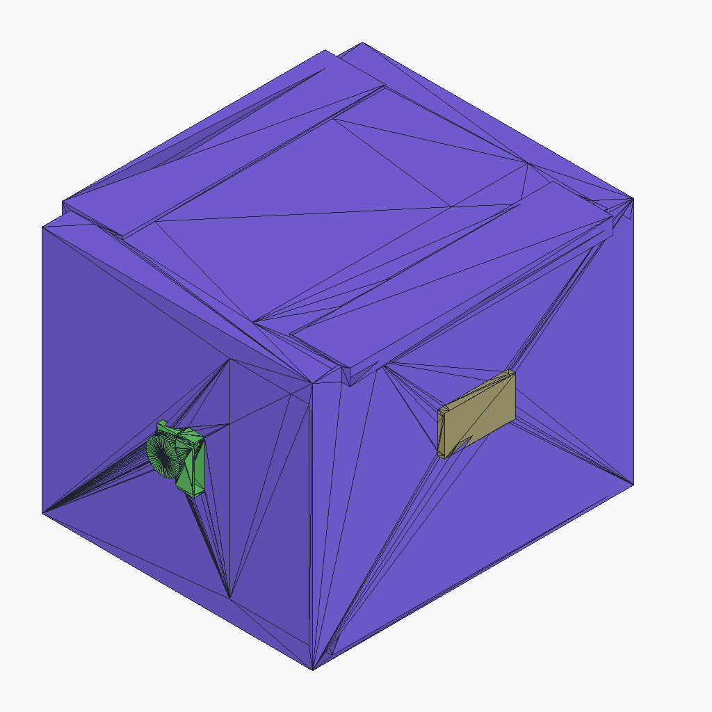
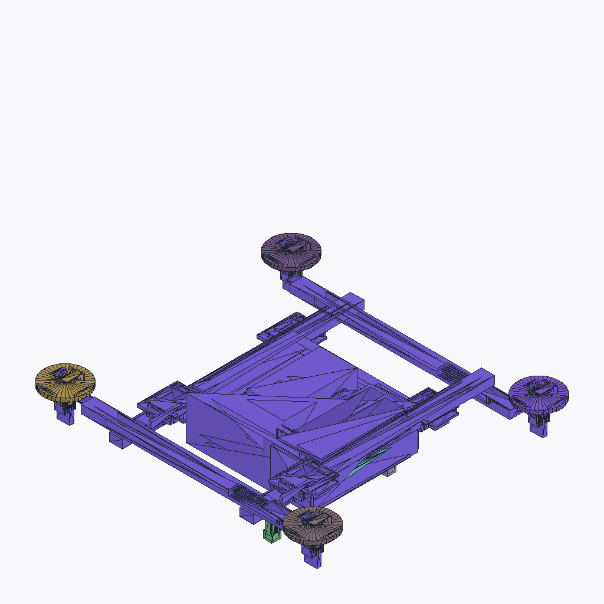
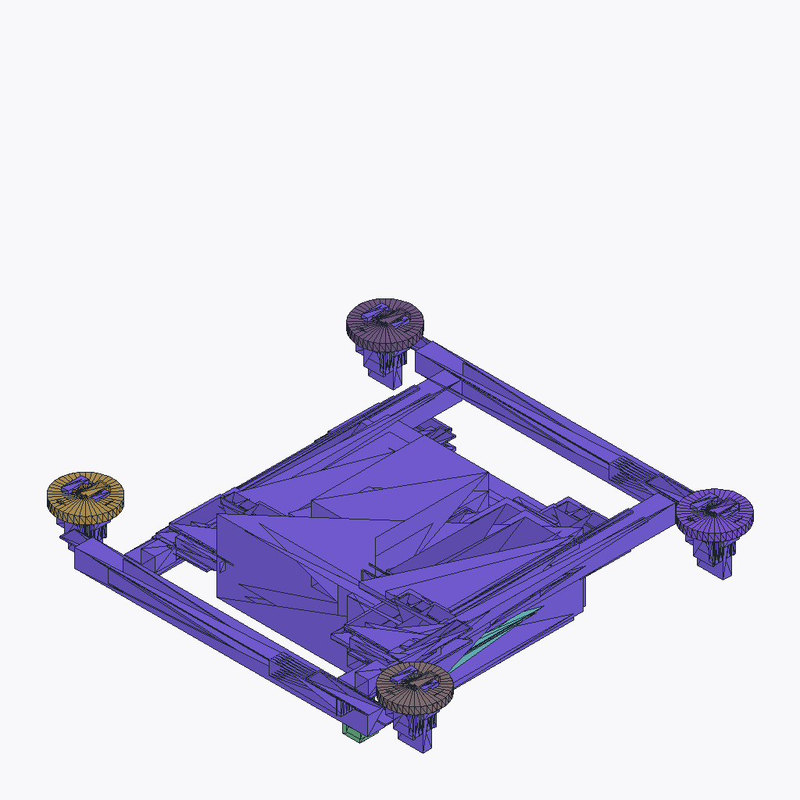
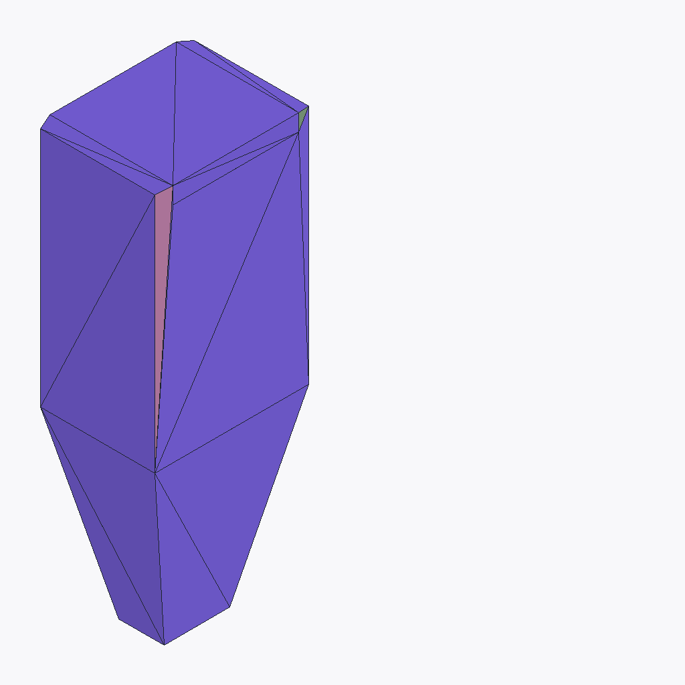

# Canonical Gallery

The canonical gallery is the smallest set of assets that must feel polished
before Lathe can claim release-quality product output. It is intentionally
small: every entry has to prove a distinct user value, build from checked-in
source, produce inspectable artifacts, and carry honest limitations.

## Flagship Workflow

The flagship workflow for the next release is:

1. Clone the repository and install the documented dev dependencies.
2. Build a canonical asset with `python -m lathe.cli build`.
3. Inspect `build_report.json`, stage bundles, validation output, and package
   artifacts under `dist/<asset>/`.
4. Import the GLB/USD output into the documented engine workflow.
5. Use diagnostics to fix a failed check without reading compiler internals.

This workflow is the product polish bar. A gallery asset is not considered
release-grade unless a new user can run the documented command, understand the
output folder, and act on certification failures.

## Gallery Set

| Slot | Source | Asset | Command | Value shown | Current limitation |
| --- | --- | --- | --- | --- | --- |
| Generate baseline | `examples/industrial_crate.lth` | `industrial_crate` | `python -m lathe.cli build examples/industrial_crate.lth industrial_crate --out dist` | Fast deterministic hard-surface prop generation. | Must keep certification and package manifest green on every release candidate. |
| Generate hero | `examples/courier_drone.lth` | `courier_drone` | `python -m lathe.cli build examples/courier_drone.lth courier_drone --out dist` | Multi-part mechanical assembly with provider traceability. | Clean-clone deterministic build evidence is still required for release. |
| Mobile target | `examples/courier_drone.lth` | `courier_drone_mobile` | `python -m lathe.cli build examples/courier_drone.lth courier_drone_mobile --out dist` | Same source family retargeted for tighter runtime budgets. | Runtime-budget report must remain clear enough for non-maintainers. |
| Reconstruct from mesh | `examples/reconstruct_courier_from_mesh.lth` | `reconstruct_courier_from_mesh` | `python -m lathe.cli build examples/reconstruct_courier_from_mesh.lth reconstruct_courier_from_mesh --out dist` | Reference-conditioned reconstruction path without remote services. | External GLB/USD viewer validation is still pending. |
| Engine handoff | `examples/console_terminal_mobile_adapt.lth` | `console_terminal_mobile` | `python -m lathe.cli build examples/console_terminal_mobile_adapt.lth console_terminal_mobile --out dist` | Engine-oriented mobile adapt flow with budgeted outputs. | This remains a gallery target until certification and import checks are repeatable. |

The gallery deliberately includes generate, reconstruct, mobile, high-detail,
and engine-targeted workflows. Broader examples remain valuable regression and
language coverage, but they do not define the release polish bar.

## Rendered Previews

These turntable previews are checked-in examples generated from the gallery
builds' `stages/package/previews/turntable.png` output.

| Asset | Preview |
| --- | --- |
| `industrial_crate` |  |
| `courier_drone` |  |
| `courier_drone_mobile` |  |
| `reconstruct_courier_from_mesh` |  |
| `console_terminal_mobile` |  |

## Acceptance Criteria

Each gallery build must satisfy these structural checks before release:

- `check`, `plan`, `materialize`, and `build` complete from a clean checkout.
- `build_report.json` records the selected provider, actual provider, asset
  name, variant when applicable, stage status, output paths, and diagnostics.
- `outputs/` includes the promised GLB/USD artifacts or a structured failure
  explaining why they were not written.
- `stages/package/bundle.json` and engine manifests name the emitted artifacts
  without absolute local paths.
- Validation reports include topology, UV, material-slot, collision, LOD,
  scale, naming, and package-completeness metrics when those contracts apply.
- Certification failures name the stage, rule, expected value, actual value,
  and the artifact or source location the user should inspect.
- Fallback or offline providers identify themselves honestly and do not claim
  learned-generation quality.

Each gallery build must satisfy these visual and product checks before release:

- The output opens in at least one automated or external GLB/USD viewer.
- The first rendered preview shows the whole asset, correct scale, expected
  orientation, and no missing material zones.
- The documented preview media set is
  `stages/package/previews/turntable.png`,
  `stages/package/previews/wireframe.png`,
  `stages/package/previews/uv_layout.png`, and
  `stages/package/previews/lod_sheet.png`.
- Known limitations are documented next to the gallery entry rather than hidden
  in test logs.
- A release candidate archives the report, package manifest, trace manifest,
  and preview artifact for review.

## Non-Canonical Examples

Examples outside the gallery are either API demos, corpus coverage, tutorials,
or experimental targets. They may still run in CI and should not bit-rot, but
they are not proof of product polish until promoted into the gallery.

The [Examples catalog](examples_catalog.md) remains the complete inventory.
Rows whose certification status is not green are treated as experimental or
known-limitation examples until the catalog, tests, and release checklist show
fresh passing evidence.
