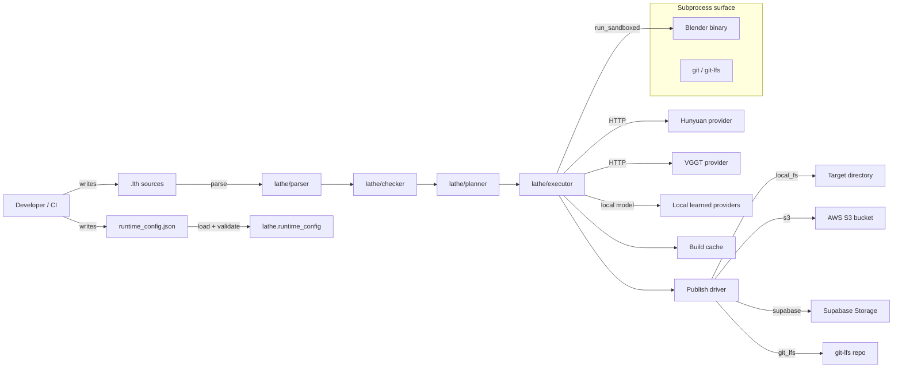

# Lathe Threat Model (SEC-6, V0.2 P0)

STRIDE-style analysis of the trust boundaries and attack surface of the
Lathe reference compiler + runtime. Per-asset/flow mitigations reference
existing guards (SEC-1 path hardening, SEC-2 mesh parser hardening,
SEC-3 gitleaks, SEC-NEW-1 provider sandbox) and flag open work as
`SEC-FUTURE-*` follow-ups.

## Scope

The runtime is a local developer tool that:

1. Parses user-authored `.lth` source and its `std/` imports.
2. Loads a user-supplied `runtime_config.json` describing providers,
   signing keys, and publish targets.
3. Invokes optional learned providers over HTTP (Hunyuan, VGGT) or
   locally (xatlas, Manifold).
4. Spawns **Blender** as a subprocess to realize the execution plan.
5. Writes a build cache under `./cache` / `./dist`.
6. Optionally publishes the build to a local filesystem, S3, Supabase
   Storage, or a git-lfs tracked repo.

The trust model treats the *user* of `lathe` as trusted. `.lth` sources
and `runtime_config.json` files are **not** treated as fully trusted — a
developer may `git clone` a third-party repo whose `.lth` sources can
attack the build host.

## Attack-surface diagram

Trust boundaries are crossed at each of the labelled edges into
`lathe/parser`, `lathe.runtime_config`, `run_sandboxed`, the HTTP
provider clients, and the four publish drivers. Everything else is
internal-controlled: produced by one of our stages and consumed by a
later one inside the same run.

## Enforceable ingress policy

The compiler now marks code chokepoints that accept untrusted input with
`lathe.security.ingress_boundary`. The annotation attaches one or more
`BoundaryPolicy` values with an `InputClass`, `TrustLevel`, and named
controls. `tests/unit/test_trust_boundaries.py` fails if the expected
untrusted boundaries lose those policies or if an untrusted policy omits
controls.

Current untrusted boundary classes:

| Input class | Entry point | Required control examples |
|---|---|---|
| `.lth` source | `lathe.parser.parse_file`, `lathe.parser.parse_text` | UTF-8 decode, byte/token/import budgets, prompt-injection scan, declarative grammar parse, safe import path resolution |
| Asset ref paths | `lathe.paths.safe_resolve` | relative-only input, canonical root containment, symlink/reparse rejection |
| External images | Shape-stage conditioning in the stable `lathe.shape.intent_mesh_handoff_v1` flow | project-relative path, format allowlist, byte and pixel caps |
| External meshes | `lathe.mesh_ingest.safe_load_mesh`; shape conditioning mesh refs | format allowlist, byte cap, magic sniff, post-load mesh sanity checks |
| Runtime config | `lathe.runtime_config.load_runtime_config` | byte cap, UTF-8 decode, JSON parse, object root, JSON schema validation |
| Network/provider IO | `lathe.net.safe_urlopen` | scheme and host allowlists, private IP rejection, redirect blocking, TLS verification, content-type and body-size checks |

## STRIDE by flow

Legend: **M** = mitigated today, **R** = residual risk (tracked as
`SEC-FUTURE-*`), **n/a** = not applicable to this flow.

### 1. `.lth` source parsing

| Category                  | Threat                                                                 | Status | Mitigation / follow-up                                                                |
|---------------------------|------------------------------------------------------------------------|--------|---------------------------------------------------------------------------------------|
| Spoofing                  | `.lth` masquerades as trusted stdlib by shadowing `std/…` path         | M      | `safe_resolve` (SEC-1) refuses traversal; stdlib lookup is bounded to `REPO_ROOT`.    |
| Tampering                 | Hostile source mutates build cache via crafted import                  | M      | Parser emits AST only; cache writes go through `lathe/cache.py` with hash keys.       |
| Tampering                 | Image refs traverse outside project or point at oversized/bomb images  | M      | Shape conditioning accepts project-relative PNG/JPEG/WebP only, with byte and pixel caps. |
| Repudiation               | Author denies authorship of a malicious source                         | R      | `SEC-FUTURE-1`: optional ed25519 signing of `.lth` modules at commit.                 |
| Info Disclosure           | String literals exfiltrate to learned providers via prompt injection   | M      | SEC-8 static scanner warns on suspected injection patterns; opt-in strict mode errors.|
| Denial of Service         | Pathological grammar (deep nesting, billion laughs) OOMs parser        | R      | `SEC-FUTURE-2`: token-budget + recursion depth caps on `_FastParser`.                 |
| Elevation of Privilege    | `.lth` evaluates arbitrary Python                                      | M      | Grammar is declarative; no `eval`/`exec`. Bandit gate asserts this.                   |

### 2. Runtime-config loading

| Category                  | Threat                                                                 | Status | Mitigation / follow-up                                                                |
|---------------------------|------------------------------------------------------------------------|--------|---------------------------------------------------------------------------------------|
| Spoofing                  | Config forges signer identity for publish driver                       | M      | Signing key is read from disk path in config; publish manifest records public key hex.|
| Tampering                 | Config injects unexpected keys to enable fallbacks                     | M      | JSON-schema validation at ingress (`lathe/runtime_config.py:165`).                    |
| Repudiation               | CI denies that a given config was used                                 | M      | `build_report.json` records `selected_backends` + provider fallback trace.            |
| Info Disclosure           | Config leaks secrets into build logs                                   | M      | SEC-3 gitleaks gate; provider HTTP client scrubs `Authorization` from error messages. |
| Denial of Service         | Config points provider URL to slow endpoint                            | M      | `safe_urlopen` timeout + `provider_sandbox` retry caps.                               |
| Elevation of Privilege    | Config rewrites `LD_PRELOAD` / `PYTHONPATH`                            | M      | `subproc._FORBIDDEN_ENV_KEYS` rejects these from both the base env and `extra_env`.   |

### 3. Provider HTTP + local model execution

| Category                  | Threat                                                                 | Status | Mitigation / follow-up                                                                |
|---------------------------|------------------------------------------------------------------------|--------|---------------------------------------------------------------------------------------|
| Spoofing                  | DNS rebinding / MITM                                                   | M      | `lathe.net.safe_urlopen` pins allowlist hosts; TLS always on.                         |
| Tampering                 | Response body redefines provider contract                              | M      | Response schemas enforced via `hunyuan_probe.schema.json` et al.                      |
| Repudiation               | Provider denies returning a given artifact                             | M      | Response SHA recorded into shape-stage bundle.                                        |
| Info Disclosure           | Provider exfiltrates `.lth` content via prompt field                   | M      | SEC-8 scanner warns on suspected injection in source; provider inputs are minimal.    |
| Denial of Service         | Provider hangs → build hangs                                           | M      | Per-call `timeout_s` via `safe_urlopen`; SEC-NEW-1 provider sandbox caps retries.     |
| Elevation of Privilege    | Local learned model loads hostile serialized weights                   | R      | `SEC-FUTURE-3`: require safetensors for learned model inputs; reject pickle.          |

### 4. Blender subprocess

| Category                  | Threat                                                                 | Status | Mitigation / follow-up                                                                |
|---------------------------|------------------------------------------------------------------------|--------|---------------------------------------------------------------------------------------|
| Spoofing                  | `$PATH` hijack supplies a fake `blender` binary                        | M      | `probe_blender` resolves + `_validate_argv` rejects symlinks on POSIX.                |
| Tampering                 | Hostile `.blend` input mutates host filesystem                         | M      | Subprocess runs in stage-dir `cwd`; `expect_files` must stay inside `cwd`.            |
| Repudiation               | Build report hides which Blender was used                              | M      | `blender_execution_ir` records probed path + pinned version intent.                   |
| Info Disclosure           | Blender Python script reads `~/.ssh` / env secrets                     | M      | SEC-7 sandbox scrubs env to allowlist; Blender launched with `--factory-startup`.     |
| Denial of Service         | Runaway Blender process pins CPU/RAM                                   | M      | SEC-7 sandbox enforces CPU + memory caps + 600s timeout; results are structured.     |
| Elevation of Privilege    | Autoexec runs attacker-controlled script                               | R      | `SEC-FUTURE-4`: surface `safety_policy.allow_autoexec=false` as default-deny in CLI.  |

### 5. Build-cache access

| Category                  | Threat                                                                 | Status | Mitigation / follow-up                                                                |
|---------------------------|------------------------------------------------------------------------|--------|---------------------------------------------------------------------------------------|
| Spoofing                  | Cache-key collision replaces prior stage output                        | M      | Cache keys include buildHash + stage id; verified by `.lathe_snapshot.json`.          |
| Tampering                 | Concurrent process mutates cache under a running build                 | R      | `SEC-FUTURE-5`: advisory file lock (`lathe.cache.lock`) per cache root.               |
| Repudiation               | Cached bundle claims to come from a different build                    | M      | SEC-NEW-2 signed reproducibility receipts cover the final build + stage digests.      |
| Info Disclosure           | Cache holds secrets (rare, but possible in `refs/`)                    | M      | SEC-3 gitleaks scan runs on cache-adjacent paths; cache defaults to `.gitignore`d.    |
| Denial of Service         | Cache fills disk                                                       | R      | `SEC-FUTURE-6`: cache eviction policy (size-bounded LRU).                             |
| Elevation of Privilege    | n/a                                                                    | n/a    | Cache is not executable.                                                              |

### 6. Publish driver (`local_fs` / `s3` / `supabase` / `git_lfs`)

| Category                  | Threat                                                                 | Status | Mitigation / follow-up                                                                |
|---------------------------|------------------------------------------------------------------------|--------|---------------------------------------------------------------------------------------|
| Spoofing                  | Attacker publishes under a developer's identity                        | M      | ed25519 manifest + SEC-NEW-2 receipt embed the public key used.                       |
| Tampering                 | Artifact swapped post-upload                                           | M      | Manifest lists per-artifact sha256; receipt is signed and validates via schema.       |
| Repudiation               | Publisher denies a given build produced these artifacts                | M      | SEC-NEW-2 receipt records signer id, timestamp, env fingerprint, stage digests.       |
| Info Disclosure           | Signing key leaks via commit into git-lfs repo                         | M      | Drivers never copy the key into the target dir; SEC-3 gitleaks gate catches leakage.  |
| Denial of Service         | S3/Supabase upload stalls pipeline                                     | M      | `timeout_s` on each `safe_urlopen` + boto3 retries.                                   |
| Elevation of Privilege    | Attacker supplies bucket pointing to their own ACL                     | R      | `SEC-FUTURE-7`: require runtime_config publish target to be on an allowlist.          |

## Mitigation summary (cross-reference)

| Guard                                         | Where it lives                                              |
|-----------------------------------------------|-------------------------------------------------------------|
| Path-traversal hardening                      | `lathe/paths.py::safe_resolve` (SEC-1)                      |
| Mesh parser hardening                         | `lathe/parser/binary.py` guards (SEC-2)                     |
| Gitleaks + SBOM + CodeQL + Bandit + Semgrep   | `.github/workflows/security.yml`, `codeql.yml` (SEC-3/4/5)  |
| Provider HTTP sandbox                         | `lathe/providers/sandbox.py` (SEC-NEW-1)                    |
| Blender subprocess sandbox                    | `lathe/sandbox/blender.py` (SEC-7, this ticket)             |
| Prompt-injection static scanner               | `lathe/parser/prompt_injection.py` (SEC-8, this ticket)     |
| Signed reproducibility receipts               | `lathe/publish/signed_repro.py` (SEC-NEW-2, this ticket)    |

See [`blender_sandbox.md`](blender_sandbox.md) for platform-specific
Blender subprocess sandbox behavior and known limits.

## Open follow-ups (filed)

- `SEC-FUTURE-1` — optional ed25519 signing of `.lth` modules at commit
- `SEC-FUTURE-2` — token + recursion budget caps on `_FastParser`
- `SEC-FUTURE-3` — require safetensors for learned-model ingress
- `SEC-FUTURE-4` — default-deny Blender autoexec in the CLI surface
- `SEC-FUTURE-5` — advisory file lock on cache root
- `SEC-FUTURE-6` — size-bounded LRU cache eviction
- `SEC-FUTURE-7` — runtime-config publish target allowlist

## Review cadence

Refresh on every tagged release. Any new external ingress (new provider,
new publish driver, new subprocess) must add a row to the relevant
section of this document before merge.
