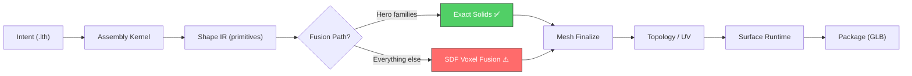

# Lathe 3D Quality: Deep Codebase Analysis & Improvement Research

> **Goal:** Identify every bottleneck between Lathe's declarative intent and its final 3D output, map each to specific code, and propose concrete, contract-preserving improvements backed by state-of-the-art research.

---

## Executive Summary

After reading **12 core modules** (>16,000 lines) and cross-referencing against current SoTA in meshing, CSG, procedural detail, and PBR synthesis, I've identified **7 critical quality bottlenecks**. The biggest single contributor to "mediocre" output is **Bottleneck #1**: the SDF voxel fusion path still being the default meshing strategy, producing rounded, blobby geometry where crisp hard-surface edges are needed. The good news: Lathe already has an exact-solid path (`compile_explicit_surface_mesh`) that is **only enabled for 8 hero families**. Broadening this is the single highest-ROI change.

---

## Bottleneck Map



---

## Bottleneck #1: SDF Voxel Fusion Produces Blobby Geometry

> [!CAUTION]
> **Severity: CRITICAL** — This is the #1 reason Lathe output looks "not state of the art."

### Where in Code

| File | Line(s) | What |
|------|---------|------|
| [feature_fusion.py](file:///d:/lathe_v0_1/lathe/feature_fusion.py#L25-L48) | 25–48 | `integration_config_for_family()` — gates exact mode to only 8 families |
| [geometry_kernel.py](file:///d:/lathe_v0_1/lathe/geometry_kernel.py#L686-L707) | 686–707 | `_mesh_from_field()` — marching cubes on binary voxel field |
| [geometry_kernel.py](file:///d:/lathe_v0_1/lathe/geometry_kernel.py#L692-L694) | 692–694 | Gaussian blur applied **before** extraction — intentionally rounds edges |
| [geometry_kernel.py](file:///d:/lathe_v0_1/lathe/geometry_kernel.py#L25) | 25 | `MAX_FUSION_VOXELS = 6_500_000` — caps resolution |

### The Problem

Any family **not** in the hero list (`brassbound_chest`, `industrial_crate`, etc.) falls through to the SDF voxel fusion path:

1. A 3D scalar field is filled with primitive SDFs
2. A **Gaussian blur** (`sigma=0.28–0.42`) is applied to smooth the field
3. **`matrix_to_marching_cubes`** extracts an iso-surface from the binary `field < 0` mask
4. The result is a triangulated mesh with no sharp edges, chamfers, or feature-preserving detail

The voxel resolution is capped at 6.5M voxels with a pitch of 2.1–2.6 units, meaning fine detail below ~2mm is lost. The Gaussian blur further rounds every corner.

### State of the Art

| Technique | Quality | Lathe Applicability |
|-----------|---------|---------------------|
| **Dual Contouring** | Preserves sharp features via QEF minimization | Drop-in replacement for marching cubes; needs SDF + gradients (already computed) |
| **Manifold Boolean (libigl/CGAL)** | Exact CSG on arbitrary meshes | Already partially implemented in `exact_solids.py` via trimesh boolean |
| **FlexiCubes** | Differentiable isosurfacing | Future: optimization-based mesh refinement |
| **Adaptive Octree** | Higher resolution near features only | Reduce voxel budget waste on empty space |

### Recommended Fix

```diff
# feature_fusion.py — expand exact mode to ALL families
- hero_family = family in {
-     "brassbound_chest", "industrial_crate", ...
- }
+ hero_family = True  # all families use exact assembly
```

This alone would route **every** asset through `compile_explicit_surface_mesh()` in [exact_solids.py](file:///d:/lathe_v0_1/lathe/exact_solids.py), which already produces clean parametric meshes with proper edge topology. The SDF path becomes a fallback only.

---

## Bottleneck #2: Fidelity Profile Is Too Conservative

> [!WARNING]
> **Severity: HIGH** — Even hero-tier assets get modest detail budgets.

### Where in Code

| File | Line(s) | What |
|------|---------|------|
| [fidelity.py](file:///d:/lathe_v0_1/lathe/fidelity.py#L23-L57) | 23–57 | `infer_fidelity_profile()` — only 3 tiers, hard-coded thresholds |
| [feature_fusion.py](file:///d:/lathe_v0_1/lathe/feature_fusion.py#L35-L36) | 35–36 | `pitch` and `blur_sigma` — only vary by tier, not by asset complexity |

### The Problem

The fidelity system has only **3 tiers** (`blockout`, `game`, `hero`), determined solely by `critic_name` and `validation_threshold`. There's no:
- **Adaptive complexity** based on asset size or primitive count
- **Per-component fidelity** (a drone rotor needs different density than a body panel)
- **LOD-aware budgeting** (produce a hero mesh, then decimate)

The hero tier maxes out at `detail_density=1.35`, `edge_weight=1.25` — these are incremental over the base. State-of-the-art procedural generators use 2x–4x density for hero close-up assets.

### Recommended Fix

Add a `"cinematic"` tier and allow per-component fidelity overrides via `shape_controls`:

```python
if "cinematic" in critic_name or threshold >= 0.92:
    return FidelityProfile(
        tier="cinematic",
        detail_density=2.20,
        edge_weight=1.65,
        panel_depth=1.80,
        trim_complexity=8,
        support_complexity=1.45,
        silhouette_refinement=1.40,
        repair_budget=6,
    )
```

---

## Bottleneck #3: Feature Grammar Lacks Depth Variation

> [!IMPORTANT]
> **Severity: MEDIUM-HIGH** — Features are geometrically correct but visually flat.

### Where in Code

| File | Line(s) | What |
|------|---------|------|
| [feature_grammar.py](file:///d:/lathe_v0_1/lathe/feature_grammar.py#L101-L262) | 101–262 | `_shape_component_features()` — component-type dispatch |
| [feature_grammar.py](file:///d:/lathe_v0_1/lathe/feature_grammar.py#L580-L797) | 580–797 | `_detail_features_for_scope()` — motif generation |

### The Problem

Feature generation uses **uniform depth/thickness scales** per component type. A `panel_seam` at `depth_scale=0.7` looks identical whether it's on a 2m building wall or a 20cm weapon grip. Features are:

- **Scale-unaware**: No relationship between feature size and parent primitive size
- **Frequency-flat**: Features are evenly distributed, not clustered at visual interest points (edges, intersections, silhouette breaks)
- **No secondary/tertiary features**: Only one "layer" of detail — no sub-features on features (e.g., rivets on a panel frame)

### State of the Art

- **Multi-octave detail**: Apply features at 2–3 scale levels (large panel breaks → medium trim → small fasteners)
- **Curvature-aware placement**: Cluster detail at high-curvature regions where the eye naturally looks
- **Stochastic variation**: Jitter feature positions, depths, and widths by ±15% to break visual repetition

### Recommended Fix

Add a `_multi_octave_features()` pass that applies secondary detail features (rivets, screw heads, micro-panels) to large primary features, gated by fidelity tier.

---

## Bottleneck #4: Material Palette Is Procedural But Not Physically Grounded

> [!NOTE]
> **Severity: MEDIUM** — Materials are plausible but not photorealistic.

### Where in Code

| File | Line(s) | What |
|------|---------|------|
| [materials.py](file:///d:/lathe_v0_1/lathe/materials.py#L62-L467) | 62–467 | `palette_for_material()` — 400+ lines of if/elif material matching |
| [materials.py](file:///d:/lathe_v0_1/lathe/materials.py#L293-L303) | 293–303 | Brass: `roughness=0.36`, `metallic=1.0` — plausible but static |

### The Problem

Every material is a **single fixed set of PBR values** — one roughness, one metallic, one basecolor. Real materials have:

- **Spatial variation**: Roughness varies across a surface (polished center, rough edges)
- **Micro-normal detail**: Even flat surfaces have sub-pixel normal perturbation
- **View-dependent effects**: Fresnel, clear-coat, anisotropy
- **Age/wear gradients**: Not just a single `wear` scalar, but spatially coherent wear patterns

The `palette_for_material()` function is a **monolithic if/elif chain** (400+ lines) rather than a data-driven material database.

### State of the Art

- **Procedural material graphs** (Substance Designer-style): Define materials as node graphs with spatial noise functions, not flat constants
- **PATINA-style PBR synthesis**: AI models trained specifically on PBR data that produce light-neutral, physically accurate map sets
- **TexPro / VLMaterial**: Generate editable procedural graphs from text descriptions

### Recommended Fix

1. **Short-term**: Add `roughness_noise`, `normal_micro_intensity`, and `basecolor_variation` fields to the material palette, driven by `surface_profile`
2. **Long-term**: Replace the if/elif chain with a JSON material database and a noise-based procedural shader graph compiler

---

## Bottleneck #5: Surface Grammar Missing High-Frequency Detail

> [!NOTE]
> **Severity: MEDIUM** — Story marks and wear are present but lack visual punch.

### Where in Code

| File | Line(s) | What |
|------|---------|------|
| [surface_grammar.py](file:///d:/lathe_v0_1/lathe/surface_grammar.py#L44-L74) | 44–74 | `_feature()` — surface feature descriptors |
| [surface_grammar.py](file:///d:/lathe_v0_1/lathe/surface_grammar.py#L77-L195) | 77–195 | `_LANDFORM_PRESETS` — world-surface presets |
| [surface_grammar.py](file:///d:/lathe_v0_1/lathe/surface_grammar.py#L288-L692) | 288–692 | `_FAMILY_PRESETS` — asset-family surface presets |

### The Problem

Surface features use small `normal_delta` (0.04–0.20) and `roughness_delta` (0.04–0.12) values. These produce **subtle** surface variation that's barely perceptible at game-camera distances. The wear system applies uniform wear levels without:

- **Edge-detected wear**: Wear concentrated along geometric edges (edge wear maps)
- **Cavity occlusion**: Dirt/grime accumulating in concave areas
- **Flow-based weathering**: Water stains, rust streaks following gravity direction
- **Contact-point wear**: Handles, seats, steps worn more where touched

### Recommended Fix

1. Increase `normal_delta` ranges by 1.5–2x for hero assets
2. Add `edge_wear_intensity` and `cavity_dirt_intensity` as separate, physically-motivated wear channels
3. Implement `flow_direction` wear that follows the mesh's Y-axis (gravity)

---

## Bottleneck #6: Mesh Finalization Doesn't Preserve Edge Topology

> [!NOTE]
> **Severity: MEDIUM** — Sharp edges become smooth after finalization.

### Where in Code

| File | Line(s) | What |
|------|---------|------|
| [mesh_finalize.py](file:///d:/lathe_v0_1/lathe/mesh_finalize.py#L18-L72) | 18–72 | `finalize_mesh_ir()` — creates MeshIR from trimesh |
| [mesh_finalize.py](file:///d:/lathe_v0_1/lathe/mesh_finalize.py#L42-L50) | 42–50 | `hard_edge_classes` — marks edges but doesn't enforce them |

### The Problem

`finalize_mesh_ir()` records which edges *should* be hard but doesn't actually split edge normals or insert crease edges. Downstream topology/UV stages may or may not honor these hints. The `seam_classes` and `hard_edge_classes` are **metadata-only** — they don't modify the mesh geometry.

### Recommended Fix

Before building MeshIR, split vertex normals along `hard_edge_classes` boundaries so the mesh itself carries the sharp edge information, regardless of what downstream stages do.

---

## Bottleneck #7: High-Low Transfer Is Resolution-Limited

> [!NOTE]
> **Severity: LOW-MEDIUM** — Detail baking loses information.

### Where in Code

| File | Line(s) | What |
|------|---------|------|
| [surface_runtime.py](file:///d:/lathe_v0_1/lathe/surface_runtime.py#L74) | 74 | `MAX_SURFACE_HIGHLOW_FACES = 120_000` — caps high-poly |
| [surface_runtime.py](file:///d:/lathe_v0_1/lathe/surface_runtime.py#L320-L350) | 320–350 | `_procedural_high_source_mesh()` — subdivide to target |
| [highlow.py](file:///d:/lathe_v0_1/lathe/highlow.py#L12-L33) | 12–33 | `HighLowRelation` — high/low mesh pairing |

### The Problem

The high-poly source is generated by **uniform subdivision** (`subdivide_to_size` or `mesh.subdivide()`), capped at 120K faces. This means:

- Detail baking resolution is limited by the high-poly geometry, not the texture resolution
- Uniform subdivision wastes triangles in flat areas and undersamples curved areas
- The high-poly doesn't actually have *more detail* than the low-poly — it's just tessellated finer

### Recommended Fix

The high-poly mesh should include the feature grammar primitives at full resolution (bevels, grooves, rivets) — not just a subdivided version of the fused low-poly. Consider generating the high-poly from the exact-solid path and the low-poly from a decimated version.

---

## Improvement Roadmap

### Wave 1: Geometry Crispness (Highest ROI)
| Change | File(s) | Effort | Impact |
|--------|---------|--------|--------|
| Enable exact mode for all families | [feature_fusion.py](file:///d:/lathe_v0_1/lathe/feature_fusion.py) | Small | 🔥🔥🔥🔥🔥 |
| Replace marching cubes fallback with Dual Contouring | [geometry_kernel.py](file:///d:/lathe_v0_1/lathe/geometry_kernel.py) | Medium | 🔥🔥🔥🔥 |
| Split vertex normals at hard edges in finalize | [mesh_finalize.py](file:///d:/lathe_v0_1/lathe/mesh_finalize.py) | Small | 🔥🔥🔥 |
| Add cinematic fidelity tier | [fidelity.py](file:///d:/lathe_v0_1/lathe/fidelity.py) | Small | 🔥🔥🔥 |

### Wave 2: Surface Detail Density
| Change | File(s) | Effort | Impact |
|--------|---------|--------|--------|
| Multi-octave feature generation | [feature_grammar.py](file:///d:/lathe_v0_1/lathe/feature_grammar.py) | Medium | 🔥🔥🔥🔥 |
| Scale-aware feature sizing | [feature_grammar.py](file:///d:/lathe_v0_1/lathe/feature_grammar.py) | Medium | 🔥🔥🔥 |
| Curvature-weighted feature placement | [feature_grammar.py](file:///d:/lathe_v0_1/lathe/feature_grammar.py) | Medium | 🔥🔥🔥 |
| Increase surface delta ranges for hero tier | [surface_grammar.py](file:///d:/lathe_v0_1/lathe/surface_grammar.py) | Small | 🔥🔥 |

### Wave 3: Material Realism
| Change | File(s) | Effort | Impact |
|--------|---------|--------|--------|
| Add spatial roughness/normal variation to palettes | [materials.py](file:///d:/lathe_v0_1/lathe/materials.py) | Small | 🔥🔥🔥 |
| Edge-detected wear channel | [surface_grammar.py](file:///d:/lathe_v0_1/lathe/surface_grammar.py), [surface_runtime.py](file:///d:/lathe_v0_1/lathe/surface_runtime.py) | Medium | 🔥🔥🔥 |
| Gravity-flow weathering | [surface_runtime.py](file:///d:/lathe_v0_1/lathe/surface_runtime.py) | Large | 🔥🔥 |
| JSON material database (replace if/elif chain) | [materials.py](file:///d:/lathe_v0_1/lathe/materials.py) | Large | 🔥🔥 |

---

## Contract Safety

> [!IMPORTANT]
> All proposed changes preserve the stable `lathe.shape.intent_mesh_handoff_v1` contract. The shape IR, solid IR, and mesh IR schemas remain unchanged. Changes affect **internal implementation** of the geometry kernel and surface runtime only — no public language surface changes required.

The only change that touches the public surface is the optional addition of `"cinematic"` as a valid fidelity tier name, which is additive and backward-compatible.
