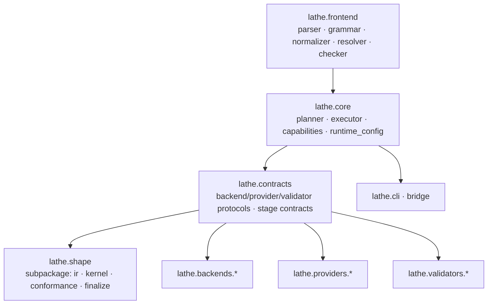

# Implementation Plan: Architecture 8/10 → 10/10

## Overview

Lathe's pipeline is clean at the stage-contract level but the shape subsystem, provider mux, and parser have accreted responsibilities that blur ownership. This plan tightens module seams, formalizes extension points, enforces layering with tooling, introduces ADR practice, and proves the plugin model via a second backend stack — without touching the stable `lathe.shape.intent_mesh_handoff_v1` contract.

## Target Architecture



Rule: arrows are allowed import directions; no cycles, no upward imports.

---

## Phase 1 — Shape subsystem seam cleanup

| Current file | New location | Responsibility |
|---|---|---|
| `asset_graph.py` | `lathe/shape/graph.py` | Intent → AssetGraph only |
| `assembly_kernel.py`, `scaffold_compiler.py` | `lathe/shape/kernel/{blueprint.py, scaffold.py}` | Blueprint + fused search geometry |
| `shape_ir.py`, `feature_grammar.py`, `feature_fusion.py` | `lathe/shape/ir/{shape_ir.py, features.py, fusion.py}` | Pure data + feature algebra |
| `mesh_finalize.py` | `lathe/shape/finalize.py` | Authoritative mesh finalization |
| `conformance.py` | `lathe/shape/conformance.py` | Provider proposal fit |
| `shape_backend.py` (geometry helpers) | `lathe/shape/geometry/{primitives.py, conditioning.py, candidates.py}` | Split: primitives, ref conditioning, candidates |
| `shape_backend.py` (orchestrator) | `lathe/shape/backend.py` | Thin: graph → scaffold → provider → conformance |
| `shape_providers.py` (registry + mux) | `lathe/providers/{registry.py, mux.py}` | Pure selection + fallback |
| `shape_providers.py` (HTTP I/O) | `lathe/providers/transport/http.py` | `urllib` behind `Transport` protocol |
| `shape_providers.py` (adapters) | `lathe/providers/adapters/{reference_conditioned,hunyuan,vggt}.py` | One adapter per provider |

**Back-compat:** keep `lathe/shape_backend.py` and `lathe/shape_providers.py` as 3-line re-export shims for one release; remove after V1.4.

---

## Phase 2 — Plugin / extension architecture

1. **`lathe/contracts/` package**: `backend.py` (Protocol `StageBackend`), `provider.py` (`ShapeProvider`), `stack.py` (`BackendStack`), `validator.py` (`Validator`). Every protocol exposes `id`, `version`, `contract`, `probe()`, `run(inputs) -> artifact`.
2. **Registry + entry points** in `pyproject.toml`:
   ```
   [project.entry-points."lathe.backends"]
   [project.entry-points."lathe.providers.shape"]
   [project.entry-points."lathe.stacks"]
   [project.entry-points."lathe.validators"]
   ```
   Built-ins register via entry points too (dogfood). `lathe/contracts/registry.py` loads via `importlib.metadata.entry_points(group=...)`.
3. **`lathe doctor --plugins`** lists third-party extensions + probe status.
4. **`docs/extending.md`** with minimal external-backend example.
5. **Built-in registry locations (retain as cache).** The built-in backend and stack registries remain as module-level dicts for zero-install behavior and cold-start speed:
   - Built-in backends: `lathe/backends.py:15` (`BACKENDS` dict).
   - Built-in stacks: `lathe/backends.py:204` (`STACKS` dict).
   These dicts are authoritative when the entry-point cache is empty or stale; entry-point-registered plugins layer on top and override by matching ID. Both dicts stay populated in V1 — the plan does not rip them out.
6. **Entry-point ↔ runtime_config precedence rule.** After Phase 2 there are two registration mechanisms (installed entry points) and one selection mechanism (`examples/runtime_configs/*.json`). The rule:
   - **Entry points register *availability*.** Installing a plugin makes its ID discoverable via `importlib.metadata.entry_points(group=...)` and probeable via `lathe doctor --plugins`.
   - **`runtime_config.json` chooses *what to run*.** When both an installed entry point AND a `runtime_config` name a provider/backend for the same stage, `runtime_config` wins. The entry point merely confirms the ID is resolvable.
   - If a `runtime_config` names an ID that is neither in the built-in dicts nor discovered via entry points, the run fails fast in `checker.py` with an explicit "unknown provider/backend ID" error listing all known IDs.
   - Document in `docs/adr/0004-plugin-entry-points.md`, including the migration note that existing JSON configs (e.g., `hunyuan_http.json`, `vggt_local.json`, `auto_learned.json`) continue to work unchanged because their IDs keep their existing string form under entry-point registration.

---

## Phase 3 — Layering enforcement

`import-linter` config at `.importlinter`:

- **Contract 1 (layers):** `frontend → core → contracts → {shape, backends, providers, validators}`; forbid reverse.
- **Contract 2 (independence):** `lathe.backends.*` siblings cannot import each other.
- **Contract 3 (contracts purity):** `lathe.contracts` forbidden from importing `numpy`, `trimesh`, `PIL`, `urllib`.
- **Contract 4 (providers isolation):** `providers.adapters.*` may import `transport`, never `lathe.shape.backend`.

Wire via `scripts/check_arch.sh` + `tests/test_architecture.py`.

---

## Phase 4 — ADR practice

Create `docs/adr/`:

- `0000-template.md` (Context / Decision / Consequences / Status)
- `0001-shape-handoff-contract.md`
- `0002-blender-and-xatlas-fallback-policy.md`
- `0003-provider-mux-design.md`
- `0004-plugin-entry-points.md`
- `0005-layering-enforcement.md`
- `0006-validator-composition.md`

`docs/adr/README.md` index. Status values: Proposed | Accepted | Superseded-by-NNNN.

---

## Phase 5 — Validator composition contract

1. `lathe/contracts/validator.py`: `Validator` protocol with `name`, `stage_dependencies: list[str]`, `evaluate(runtime, asset, artifacts) -> ValidationReport`. `ValidationReport` has `score`, `passes`, `evidence`, `subreports`.
2. `lathe/validators/composition.py`: `ValidatorPipeline` topologically orders validators; composes reports into `certification_bundle`. Replaces ad-hoc call sites in `executor.py`.
3. Register the five existing validators via the `lathe.validators` entry point group.
4. Document in ADR-0006; define score aggregation (min-of-gates, weighted-sum-of-scores).

---

## Phase 6 — Second backend stack (plugin model proof)

The plugin model needs two proof stacks with different depths. `uv_sheet_decal_v1` alone is architecturally thin — it only swaps one stage (UV) and reuses three, so it exercises stack registration and adapter swap but does **not** exercise stage-boundary contracts across multiple swaps or custom validators. We therefore split Phase 6 into a shallow plumbing proof and a deep contract proof.

### Phase 6a — Shallow proof (plumbing only): `lathe.stack.uv_sheet_decal_v1`

Validates stack registration + single adapter swap via the entry-point mechanism from Phase 2.

- Binds: `shape → intent_mesh_handoff_v1` (reused), `topology → blender_hard_surface_v1` (reused), `uv → lathe.uv.trim_sheet_v1` (new stub at `lathe/backends/uv/trim_sheet.py`), `package → openusd_gltf_v1` (reused).
- `lathe.uv.trim_sheet_v1`: `supported_tile_modes=["trim_sheet"]`, `supported_sets=["base","detail"]`; falls back to xatlas when absent.
- New fixture `examples/wall_panel_trim.lth` + test `tests/test_stack_uv_sheet.py`.
- Migrate `hard_surface_game_asset_v1` out of `BACKENDS`/`STACKS` dicts into `lathe/backends/stacks/hard_surface_game_asset_v1.py` registered via entry point; keep dicts as built-in cache (see Phase 2 item 5).
- Explicitly scoped as **UV-only plugin coverage** — does not prove topology or validator extensibility on its own.

### Phase 6b — Deep proof (two stages swapped + custom validator): `lathe.stack.soft_surface_prop_v1`

Owned by Plan 08; referenced here for architectural completeness. This is the real extension-point proof.

- Binds: `shape → intent_mesh_handoff_v1` (reused), `topology → lathe.topology.subdivision_v1` (**new, swapped**, non-Blender path forcing topology-output compatibility with a different backend), `uv → lathe.uv.soft_padding_v1` (**new, swapped**), `package → openusd_gltf_v1` (reused).
- Adds a custom validator (`lathe.validators.silhouette_soft_v1`) registered via the `lathe.validators` entry point, proving Phase 5's validator composition contract end-to-end.
- Truly exercises the plugin model: two stage swaps + one custom validator composed into the `ValidatorPipeline`.
- See Plan 08 for topology/UV/validator implementation details; Plan 03 only tracks the architectural proof it provides.

**Phase 6 completion criterion:** both 6a and 6b land, discovered exclusively via entry points, with `lathe doctor --plugins` showing all four new registrations (stack, topology backend, UV backend, validator).

---

## Phase 7 — Circular import / god-module audit

1. `python -m pydeps lathe --max-bacon=2 --noshow -o deps.svg`; attach to ADR-0005.
2. Targets, in priority order (largest/most tangled first):
   1. **`executor.py` (2,315 LOC — top priority)** — the real god-module, larger than `parser.py`. `BuildExecutor` spans ~940 lines in a single class and dispatches all 11 stages inline. Per-stage step bodies move into `lathe/core/stages/{shape,topology,uv,surface,execution,rig,interfaces,physics,optimize,validate,package,publish}.py`; `executor.py` becomes a thin dispatcher capped at **≤500 LOC**. Coordinate with Plan 01 (which owns the raw LOC-split mechanics and per-file budgets); Plan 03 owns the semantic layering — `stages/` lives under `lathe/core/` and each stage module depends only on `lathe.contracts` + its stage inputs. Introduce a `StageContext` dataclass for shared runtime/IR state before splitting so the constructor coupling in `executor.py:81` doesn't migrate wholesale. Gets its own ADR (`0007-stage-dispatcher.md`).
   2. `parser.py` (1,666 LOC) → `lathe/frontend/parser/{grammar_loader.py, ast_builder.py, ref_resolver.py, cache.py}`. Max 600 LOC per file.
   3. `shape_providers.py` (998 LOC) → per Phase 1.
3. **Capability-probe deduplication.** Probes (`probe_blender`, `probe_hunyuan_endpoint`, `probe_vggt`, `probe_topology_backend`, `probe_uv_backend`, torch/network checks) are currently called from 7 modules: `capabilities.py`, `doctor.py`, `executor.py`, `blender_execution.py`, `bridge/blender_plan.py`, `shape_providers.py`, `codex_imagegen_bridge.py`. Consolidate into `lathe.capabilities` with memoized accessors (per-process cache keyed on environment signature); all other modules — including `StageBackend.probe()` implementations from Phase 2 — call through it. `lathe.capabilities` is the *only* source of truth; no backend or doctor re-implements detection.
4. `tests/test_no_cycles.py` using import-linter or networkx.

---

## Phase 8 — Measurable 10/10 criteria

- [ ] No module > **600 LOC** (exc. tests/generated).
- [ ] Fan-in per module ≤ **15**; fan-out ≤ **12** (measured by pydeps).
- [ ] Zero import cycles (import-linter passes).
- [ ] ≥ **6 ADRs** under `docs/adr/`, all Accepted or Proposed.
- [ ] ≥ **4 documented extension points** (backend, stack, shape-provider, validator) each with a working external-plugin fixture.
- [ ] ≥ **2 registered stacks** discovered via entry points.
- [ ] `lathe.contracts` imports no numeric/IO libraries (lint rule).
- [ ] `lathe doctor --plugins` lists discovered plugins with probe status.
- [ ] `intent_mesh_handoff_v1` unchanged; verified by `tests/test_contract_frozen.py` hashing the contract dict.

---

## Risks & Mitigations

- **Shape-subpackage move breaks imports** → one-release shim re-exports; run full pytest + `scripts/lathe_asset_loop.sh` on 4 hero examples after each sub-phase.
- **Entry-point discovery slows cold-start** → cache in `~/.lathe/plugin_cache.json` keyed by installed-distribution hash.
- **import-linter floods CI** → seed with `ignore_imports` list; tighten contract-by-contract.
- **Second stack scope creep** → `uv_sheet_decal_v1` is fallback-only delegate to xatlas; no new UV algorithm.

---

## Implementation order

1. Phase 4 ADR template + 0001/0002/0003 (no code risk)
2. Phase 2 `lathe/contracts/` protocols
3. Phase 1 shape subpackage move (behind shims)
4. Phase 5 validator composition
5. Phase 7 parser + executor splits
6. Phase 3 import-linter enforcement
7. Phase 2 entry-point registration (dogfood built-ins)
8. Phase 6 second stack
9. Phase 8 CI gates flip to strict

---

## Relevant files

- `lathe/backends.py`, `lathe/executor.py`, `lathe/shape_backend.py`, `lathe/shape_providers.py`, `lathe/parser.py`
- `lathe/validators/{semantic_quality,visual_quality,flow_quality,surface_quality,silhouette}.py`
- `pyproject.toml` (entry-point additions)
- New: `.importlinter`, `docs/adr/`, `docs/extending.md`, `lathe/contracts/`, `lathe/shape/`, `lathe/providers/`, `lathe/backends/stacks/`, `lathe/core/stages/`, `tests/test_architecture.py`, `tests/test_contract_frozen.py`, `tests/test_no_cycles.py`, `tests/test_stack_uv_sheet.py`, `examples/wall_panel_trim.lth`.

---

## Amendment log (2026-04-23)

Applied from `plans/reviews/03_architecture_review.md` plus meta-review cross-cutters.

- **Phase 7 — `executor.py` promoted to top-priority decomposition target.** At 2,315 LOC with a ~940-line `BuildExecutor` god-class, it is larger and more tangled than `parser.py`. Placed as item #1 ahead of `parser.py` (#2) and `shape_providers.py` (#3). Per-stage step bodies move into `lathe/core/stages/{shape,topology,uv,surface,execution,rig,interfaces,physics,optimize,validate,package,publish}.py`; `executor.py` becomes a thin dispatcher ≤500 LOC. Introduces a `StageContext` dataclass to decouple stage state. Plan 01 owns the LOC-split mechanics; Plan 03 owns the semantic layering (stages live under `lathe/core/`). Gets its own ADR (`0007-stage-dispatcher.md`).
- **Phase 2 — entry-point ↔ runtime_config precedence rule added.** Entry points register availability; `runtime_config.json` chooses what to run. When both name a provider/backend, `runtime_config` wins. Unknown IDs fail fast in `checker.py`. Documented in ADR-0004 with migration note for existing JSON runtime configs.
- **Phase 2 — registry dict locations confirmed.** Built-in backends at `lathe/backends.py:15` (`BACKENDS`) and built-in stacks at `lathe/backends.py:204` (`STACKS`) are retained as cache for zero-install behavior; entry-point plugins layer on top.
- **Phase 6 — split into 6a (shallow plumbing) and 6b (deep contract proof).** Acknowledged that `uv_sheet_decal_v1` alone only swaps the UV stage (UV-only plugin coverage). Added Phase 6b: `lathe.stack.soft_surface_prop_v1` (from Plan 08) swaps both topology (subdivision) and UV (soft padding) and adds a custom validator, truly exercising the stage-boundary contracts and Phase 5 validator composition. Phase 6 now requires both stacks for completion.
- **Phase 7 — capability-probe deduplication added as a new item.** Probes are duplicated across 7 modules (`capabilities.py`, `doctor.py`, `executor.py`, `blender_execution.py`, `bridge/blender_plan.py`, `shape_providers.py`, `codex_imagegen_bridge.py`). Consolidated behind `lathe.capabilities` with memoized accessors; all other modules — including `StageBackend.probe()` from Phase 2 — must call through it. `lathe.capabilities` is the sole source of truth for detection.
- **Relevant files — added `lathe/core/stages/` to the new-paths list** to reflect the executor decomposition target.
